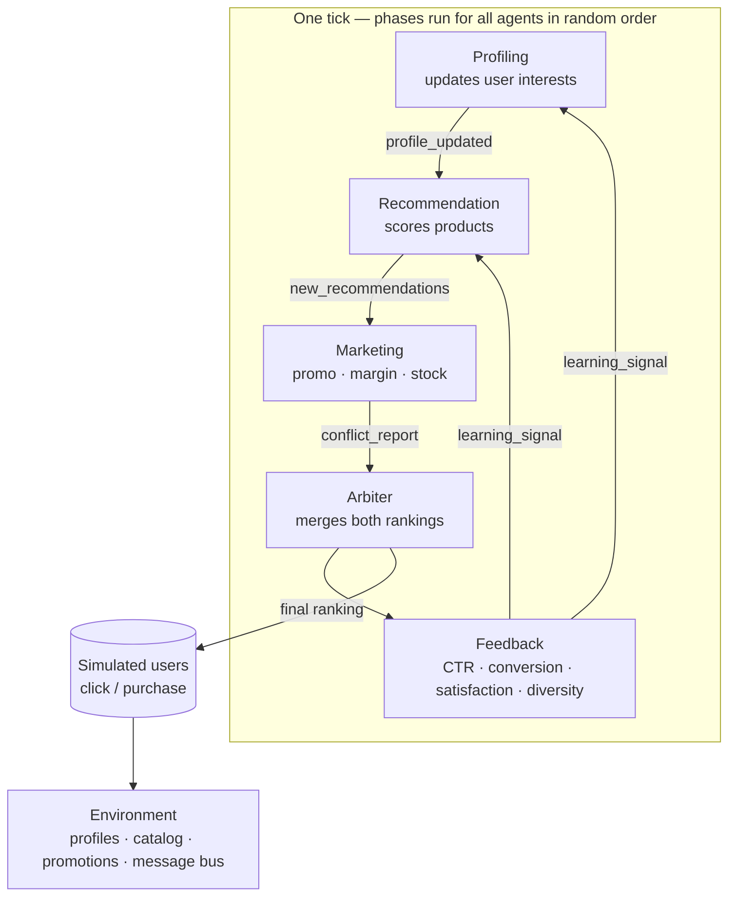
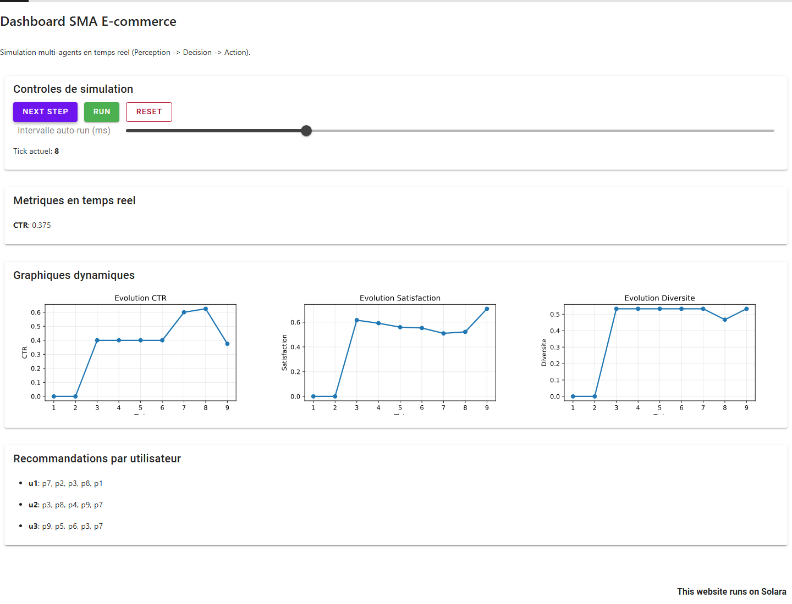

<div align="center">

# 🤖 Multi-Agent Recommendation System for E-commerce

**Five autonomous agents negotiate relevance vs. profitability inside a shared environment — built with Mesa and a live Solara dashboard.**


</div>

---

## 📌 Overview

This project re-designs a sequential recommendation pipeline as a **true multi-agent system (MAS)**. There is no fixed pipeline: at every simulation *tick* all agents **perceive → decide → act** in random order, exchange messages through a bus, and write to a shared environment. A simulated shopper then clicks/buys from the final ranking, and the resulting feedback changes the next tick.

> **What it is / is not.** The agents are **rule-based and score-based** (no LLM, no learned model), and the world is **synthetic**: 3 simulated users, 9 products and 3 promotions defined in code. It is an agent-based modelling study of cooperation and competition, not a production recommender.

## 🎯 Objectives

- Show MAS properties: autonomy, local perception, message passing, cooperation **and** competition.
- Model the classic tension between **user relevance** (Recommendation agent) and **business value** (Marketing agent), resolved by an **Arbiter**.
- Track CTR, conversion, satisfaction and diversity over time.

## 🧭 Architecture



| Agent | Perceives | Decides | Acts |
|---|---|---|---|
| **Profiling** | Last interactions, learning signals | Interest deltas per category (click +0.08, purchase +0.15; pending deltas scaled ×0.9 after an unsuccessful learning signal) | Updates and normalises user profiles |
| **Recommendation** | Profiles, in-stock catalog | `interest + 0.2·promo − price_sensitivity·price/150 + noise` | Publishes top-5 candidates |
| **Marketing** | Candidates, promotions | `0.45·relevance + 0.55·(promo + 0.15·margin ± stock term)` | Re-ranks, reports a *conflict level* |
| **Arbiter** | Both rankings, conflict level, satisfaction | Rank fusion — weight 0.5/0.5, or 0.7 on relevance when conflict > 0.45 and satisfaction < 0.55 | Writes the final ranking |
| **Feedback** | Interactions, shown rankings | CTR, conversion, satisfaction, category diversity | Updates metrics and sends learning signals |

## 📏 Metrics

`CTR` = clicks / items shown · `Conversion` = purchases / clicks · `Satisfaction` = mean profile interest of the top-3 categories · `Diversity` = distinct categories in the top-5 / 5.

## 🧰 Tech Stack

| Role | Tools |
|---|---|
| Agent-based modelling | Mesa 3.3.1 (`Model`, `Agent`) |
| Dashboard | Solara + matplotlib |
| Language | Python **≥ 3.11** (required by Mesa 3.3.1) |

## 🚀 Run

```bash
python -m venv .venv && source .venv/bin/activate      # Windows: .venv\Scripts\Activate.ps1
pip install -r requirements.txt     # Windows: enable long paths or use a short venv path (e.g. C:\venv) — Solara's dependencies exceed 260 characters

python run_simulation.py                               # 8-tick console run (seed 7)
solara run app.py --host 127.0.0.1 --port 8765         # live dashboard → http://127.0.0.1:8765
```

The dashboard offers *Next Step*, *Run/Pause*, *Reset* and an auto-run interval slider, with live CTR / conversion / satisfaction / diversity charts and the final rankings.

## 🖼️ Dashboard

<p align="center">
  
</p>

*Screenshot of the repository's own Solara app after 8 steps (seed 7), produced by running `solara run app.py` — not an edited image.*

## 📊 Results (reproducible, seed 7)

The repository ships no recorded results; running `python run_simulation.py` (Python 3.11, Mesa 3.3.1) printed:

| Tick | CTR | Conversion | Satisfaction | Diversity |
|---:|---:|---:|---:|---:|
| 1 | 0.000 | 0.000 | 0.000 | 0.000 |
| 3 | 0.400 | 0.000 | 0.617 | 0.533 |
| 5 | 0.400 | 0.000 | 0.559 | 0.533 |
| 8 | 0.625 | 0.100 | 0.522 | 0.467 |
| **Mean over 8 ticks** | **0.353** | – | **0.419** | **0.392** |

Final rankings at tick 8: `u1: p7, p2, p3, p8, p1` · `u2: p3, p8, p4, p9, p7` · `u3: p9, p5, p6, p3, p7, p8`. These are properties of a **synthetic, hand-tuned world** (3 users, 9 products): they illustrate the dynamics and are not evidence of recommendation quality.

## 📚 Further Reading

[`TECHNICAL_APPROACH.md`](./TECHNICAL_APPROACH.md) (implementation choices) and [`report.md`](./report.md) (design report, in French).

## 🔭 Limitations & Future Work

- Only 3 users / 9 products; interaction probabilities are hand-set.
- Agents do not learn parameters (weights are fixed); consider bandit / RL agents for Marketing and Arbiter.
- Replace the synthetic world with a real event log and evaluate offline (e.g. NDCG), then compare with a non-MAS pipeline baseline.
- Add unit tests for message routing and agent decisions.

## 👤 Author

**Nour Ghribi** · [GitHub](https://github.com/Nour-Ghribi)
